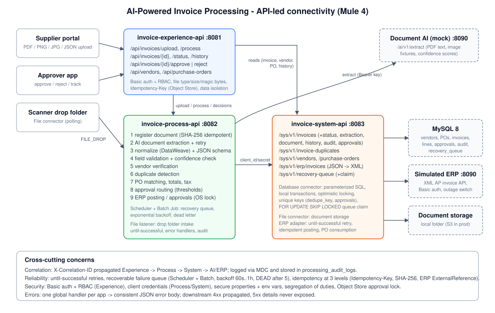
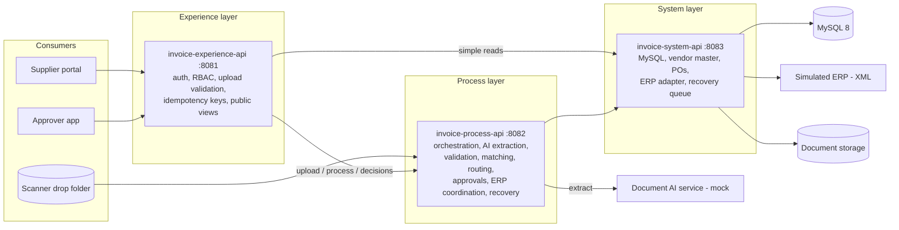
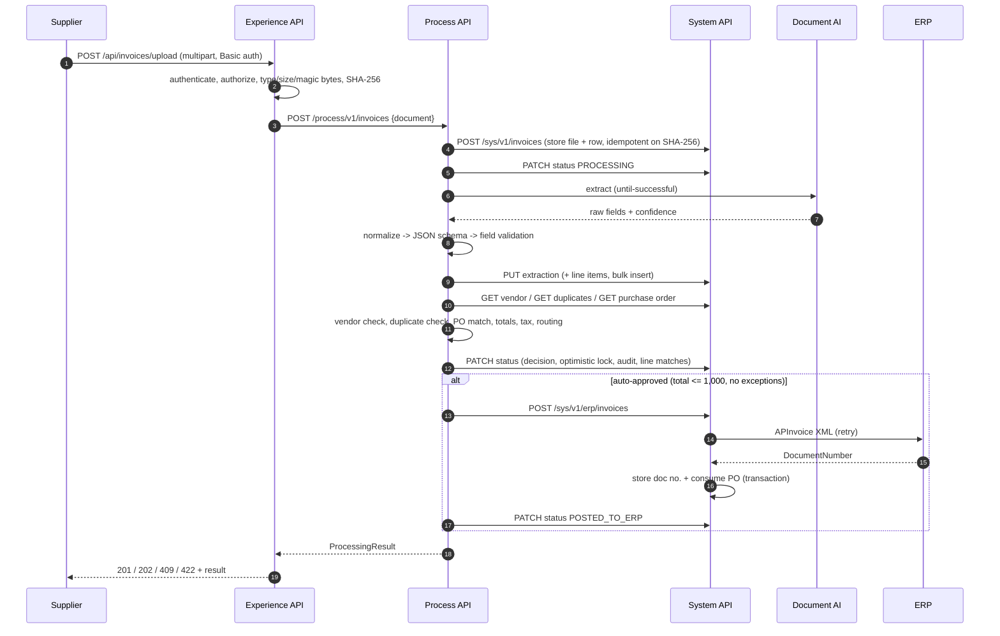
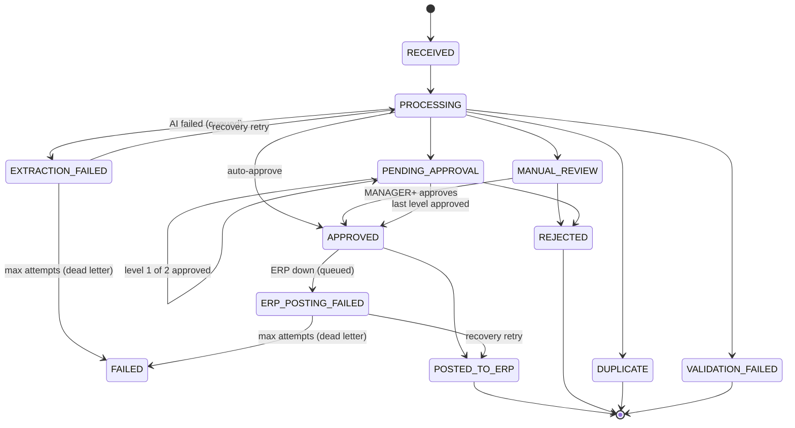

# Architecture

## 1. API-led layers

| Layer | Owns | Does **not** do |
|---|---|---|
| Experience | Consumer-facing contract, authentication, role checks, file validation, HTTP status mapping, Idempotency-Key | Business rules, persistence |
| Process | The invoice workflow and every business decision (DataWeave), retries, recovery, approval rules | SQL, ERP protocol details |
| System | Data access (parameterized SQL), transactions, ERP XML protocol, document storage | Business decisions |

**Design decision:** the Experience API reads invoices, vendors, POs and history directly from the System API. These reads need no orchestration, and an extra hop through the Process API would add latency without adding value. All writes go through the Process API.

## 2. Processing sequence (upload of a PDF)

## 3. Invoice state machine

## 4. Routing rules (approval-routing.dwl)

| Precedence | Condition | Result |
|---|---|---|
| 1 | Exact duplicate (same vendor and normalized number) | `DUPLICATE` |
| 2 | BLOCKING issue and AI confidence >= 0.50 | `VALIDATION_FAILED` (back to supplier) |
| 3 | BLOCKING issue with unreliable extraction, any REVIEW issue, or confidence < 0.85 | `MANUAL_REVIEW` (MANAGER, or FINANCE_DIRECTOR above 50k) |
| 4 | total <= 1,000 | `APPROVED`, then posted to the ERP automatically |
| 5 | total <= 10,000 | `PENDING_APPROVAL` [APPROVER] |
| 6 | total <= 50,000 | `PENDING_APPROVAL` [MANAGER] |
| 7 | total > 50,000 | `PENDING_APPROVAL` [MANAGER, FINANCE_DIRECTOR] |

All thresholds and tolerances are properties in `invoice-process-api/src/main/resources/config/*.yaml` (`approval.*`, `validation.*`).

**Issue catalogue**

| Severity | Codes |
|---|---|
| BLOCKING | MISSING_REQUIRED_FIELD, INVALID_FORMAT, UNSUPPORTED_CURRENCY, INVALID_DATE, INVOICE_TOO_OLD, INVALID_VALUE, VENDOR_NOT_FOUND, VENDOR_INACTIVE, VENDOR_NOT_IDENTIFIED, SCHEMA_VALIDATION_FAILED |
| REVIEW | LOW_CONFIDENCE, LOW_CONFIDENCE_FIELDS, PO_MISSING, PO_NOT_FOUND, PO_VENDOR_MISMATCH, PO_NOT_OPEN, PO_CURRENCY_MISMATCH, PO_AMOUNT_EXCEEDED, UNMATCHED_LINE, QUANTITY_EXCEEDS_PO, PRICE_VARIANCE, LINE_AMOUNT_MISMATCH, SUBTOTAL_MISMATCH, TOTAL_MISMATCH, TAX_RATE_MISMATCH, TAX_AMOUNT_MISMATCH, TAX_MISSING, VENDOR_NAME_MISMATCH, VENDOR_CURRENCY_MISMATCH, VENDOR_AMBIGUOUS, POSSIBLE_DUPLICATE, SUBTOTAL_MISSING |
| INFO | DUE_DATE_DERIVED, EXTRACTION_WARNING |

## 5. Reliability patterns

| Concern | Implementation | Where |
|---|---|---|
| Transient AI failures | `until-successful` (3 attempts); 4xx are not retried; 429/529/5xx are | `ai-extraction-*-sub-flow` |
| Transient ERP failures | `until-successful` in the System API, then the recoverable queue | `erp.xml`, `erp-posting-sub-flow` |
| Long outages | `recovery_queue` table, Scheduler + Batch Job, exponential backoff `60s * 2^(n-1)` capped at 1h, `DEAD` after 5 attempts (dead letter), invoice `FAILED` | `recovery.xml`, `recovery-queue.xml`, `recovery-backoff.dwl` |
| Multiple workers | `SELECT ... FOR UPDATE SKIP LOCKED` claim, stale `IN_PROGRESS` reclaimed after 15 min | `sys-claim-recovery-flow` |
| Duplicate uploads | SHA-256 unique index, so the same file returns the same invoice (`idempotentReplay`) | `sys-create-invoice-flow` |
| Client retries | `Idempotency-Key` header, so the stored response is replayed for 24h (Object Store) | Experience `idempotency-*-sub-flow` |
| Duplicate invoices | Normalized number check + `dedupe_key` STORED generated column with a UNIQUE index (race-proof) | `duplicate-detection.dwl`, `invoices.dedupe_key` |
| Double ERP posting | `erp_document_number IS NULL` guard + ERP idempotent on `ExternalReference` | `erp.xml`, mock ERP |
| Concurrent approvals | Object Store lock (`failIfPresent`), unique `(invoice, level)` and `(invoice, user)`, optimistic `version` check | `approvals.xml` |
| DB outages | Connection pool + reconnection strategy; `DB:CONNECTIVITY` maps to 503 | `global.xml` (System) |
| Traceability | `X-Correlation-ID` on every hop, MDC in log4j pattern, `processing_audit_logs.correlation_id` | all apps |

## 6. Security

| Control | Implementation |
|---|---|
| Authentication (public) | HTTP Basic against SHA-256 hashed users (`security/users.json`). In production, replace with an API Manager OAuth 2.0 / JWT policy |
| Authorization | Role checks per endpoint (`authorize-sub-flow`); approval levels APPROVER < MANAGER < FINANCE_DIRECTOR; segregation of duties; suppliers see only their own invoices |
| Service-to-service | `client_id` / `client_secret` headers between layers (replace with Client ID Enforcement policies in Anypoint) |
| Secrets | Never in code. `UPPER_SNAKE` properties are overridden by environment variables; prod uses `secure::` encrypted values plus `-Dmule.key`; `mule-artifact.json` marks them as secure (hidden in Runtime Manager) |
| Input validation | Extension allow-list, magic-byte check, size limit (Content-Length precheck and decoded size), file-name sanitising, UUID/regex checks on path params, JSON schema, parameterized SQL only |
| Transport | HTTPS on CloudHub ingress; TLS listener template in Experience `global.xml` |
| Logging | JSON event logs with ids and statuses only; no payloads, documents, credentials or tokens; 5xx bodies never expose internals |
